# Manual Técnico - HomeFinder Pro S.A.

## Índice

- [1. Introducción](#1-introducción)
- [2. Elección y Justificación del Framework](#2-elección-y-justificación-del-framework)
- [3. Elección y Justificación de Patrones de Diseño](#3-elección-y-justificación-de-patrones-de-diseño)
- [4. Componentes y Estructura del Sistema](#4-componentes-y-estructura-del-sistema)
- [5. Diagramas de Casos de Uso](#5-diagramas-de-casos-de-uso)
- [6. Requerimientos del Sistema](#6-requerimientos-del-sistema)
- [7. Matrices de Trazabilidad](#7-matrices-de-trazabilidad)
- [8. Diagramas de Secuencia](#8-diagramas-de-secuencia)

---

## 1. Introducción

### 1.1 Propósito

Documentar la arquitectura, diseño, implementación y despliegue de **HomeFinder Pro S.A.**, plataforma digital para la gestión y publicación de inmuebles.

### 1.2 Descripción General del Sistema

**HomeFinder Pro** es una plataforma web para el mercado de bienes raíces y alquiler de propiedades. Permite la administración de usuarios (agentes y clientes), propiedades, y un sistema de búsqueda avanzado. La plataforma se compone de:

1. **Frontend**: React + Vite + Tailwind CSS
2. **Backend**: API RESTful con Express.js y TypeScript, organizado en módulos independientes
3. **Base de Datos**: PostgreSQL 15.3 dockerizada, con Prisma ORM

El sistema implementa tres roles de usuario (Cliente, Agente, Administrador) con permisos específicos.

> **Grabación de reunión del equipo**: [Ver grabación en Google Drive](https://drive.google.com/file/d/12jqS7NmptNaC-R2ljdes3CAZS-amgMqk/view)

### 1.3 Alcances Funcionales

| Módulo | Funcionalidades |
|--------|----------------|
| **Autenticación** | Registro de clientes, inicio de sesión, JWT para todas las sesiones |
| **Gestión de Propiedades** | CRUD completo de inmuebles, carga de fotografías, categorización por tipo |
| **Búsqueda Avanzada** | Filtrado por tipo, precio, zona, habitaciones, baños, área; ordenamiento múltiple |
| **Citas** | Solicitud, propuesta de horarios, aceptación/rechazo con justificación |
| **Favoritos** | Guardado y gestión de propiedades favoritas por parte del cliente |
| **Dashboard del Agente** | Estadísticas Top 3 tipos de inmuebles más buscados, Top 5 zonas |
| **Gestión de Agentes** | CRUD de agentes por parte del administrador |
| **Perfiles** | Actualización de datos personales y fotografía de perfil |

### 1.4 Stakeholders

| Stakeholder | Rol | Interés en el Sistema |
|-------------|-----|----------------------|
| **HomeFinder Pro S.A.** | Empresa propietaria | Disponer de una plataforma digital para la gestión y publicación de inmuebles |
| **Clientes** | Usuarios finales | Buscar, filtrar y contactar agentes para evaluar propiedades |
| **Agentes Inmobiliarios** | Profesionales inmobiliarios | Publicar propiedades, gestionar citas y visualizar estadísticas |
| **Administrador del Sistema** | Operador interno | Gestionar los agentes inmobiliarios activos en la plataforma |


### 1.5 Usuarios del Sistema

| Actor | Tipo | Descripción | Funcionalidades principales |
|-------|------|-------------|----------------------------|
| **Cliente** | Externo | Persona que se registra en la plataforma para buscar, guardar en favoritos y contactar agentes para ver propiedades y realizar citas. | Registro con datos personales y fotografía, búsqueda y filtrado de propiedades, gestión de favoritos, solicitud de citas, aceptación/rechazo de horarios propuestos por el agente, actualización de datos personales. |
| **Agente Inmobiliario** | Externo | Profesional encargado de dar de alta, actualizar y dar mantenimiento a las propiedades publicadas en el sitio. | CRUD completo de propiedades (título, dirección, precio, descripción, fotos, habitaciones, baños, m²), gestión de tipos de inmueble, dashboard con gráficas (Top 3 tipos, Top 5 zonas), gestión de citas y propuesta de horarios. |
| **Administrador** | Interno | Encargado de la gestión operativa del sistema; su función principal es gestionar a los agentes inmobiliarios. | CRUD de agentes (crear, editar, eliminar), supervisión general del sistema, ingreso mediante credenciales (correo y contraseña). |

---

## 2. Elección y Justificación del Framework

Se seleccionaron frameworks y tecnologías que en conjunto cumplen con los requerimientos funcionales y no funcionales del sistema, priorizando productividad, mantenibilidad y ecosistema.

### 2.1 Frontend: React + Vite + Tailwind CSS

| Criterio | Justificación |
|----------|---------------|
| **¿Por qué React?** | Es la librería más adoptada para aplicaciones SPA (Single Page Application). Su modelo basado en componentes permite crear interfaces modulares y reutilizables (componentes como `PropertyCard`, `FilterPanel`, `Button`). El Virtual DOM garantiza rendimiento en listas dinámicas como los resultados de búsqueda de propiedades. |
| **¿Por qué Vite?** | Vite ofrece un arranque de servidor en milisegundos y Hot Module Replacement (HMR) instantáneo, lo que acelera el ciclo de desarrollo comparado con webpack/CRA. Además permite builds optimizados con Rollup para producción. |
| **¿Por qué Tailwind CSS?** | Tailwind es un framework CSS utility-first que elimina la necesidad de escribir CSS convencional. Permite estilizar directamente en JSX, reduce el código muerto mediante purging, y facilita la creación de interfaces responsivas con breakpoints integrados. |
| **¿Por qué React Router DOM?** | Proporciona routing declarativo SPA para las vistas del sistema (HomePage, LoginPage, RegisterPage, SearchPage), con navegación sin recarga de página. |

### 2.2 Backend: Express.js + TypeScript

| Criterio | Justificación |
|----------|---------------|
| **¿Por qué Express.js?** | Es el framework HTTP más usado en Node.js. Su enfoque minimalista y sin opiniones permite estructurar el backend como se necesite (en este caso, modular por dominio). El ecosistema de middleware es vasto: se usa `cors`, `express-validator`, middleware de autenticación JWT, etc. |
| **¿Por qué TypeScript?** | El tipado estático previene errores en tiempo de compilación, mejora el autocompletado/IntelliSense y facilita el refactoreo seguro. Combinado con Prisma, se obtienen queries completamente tipadas contra la base de datos, eliminando errores de runtime por campos inexistentes o tipos incorrectos. |

### 2.3 Base de Datos: PostgreSQL + Prisma ORM

| Criterio | Justificación |
|----------|---------------|
| **¿Por qué PostgreSQL?** | RDBMS robusto con soporte completo para transacciones ACID, integridad referencial con foreign keys, índices, y tipos de datos ricos (`NUMERIC`, `TIMESTAMP`, `VARCHAR`). Es necesario para un sistema con múltiples relaciones (usuarios → propiedades → favoritos → citas → imágenes). |
| **¿Por qué Prisma ORM?** | Prisma genera un cliente tipado a partir del schema, lo que permite queries type-safe en TypeScript. Sus migraciones versionadas (`prisma migrate`) mantienen el esquema sincronizado entre entornos. El adapter `@prisma/adapter-pg` con pool nativo de `pg` ofrece control fino sobre las conexiones. |

### 2.4 Infraestructura: Docker + Docker Compose

| Criterio | Justificación |
|----------|---------------|
| **¿Por qué Docker?** | Containerizar el backend y la base de datos garantiza que el entorno sea **idéntico** en la máquina de cualquier desarrollador y en producción. Elimina el problema de "funciona en mi máquina". |
| **¿Por qué Docker Compose?** | Permite orquestar los dos servicios (PostgreSQL + backend) con un solo `docker-compose up`. El healthcheck asegura que el backend no arranque hasta que PostgreSQL esté disponible. |

### 2.5 Resumen de Tecnologías

| Tecnología | Versión | Rol en el sistema |
|------------|---------|-------------------|
| React | 19.2 | UI: Componentes reactivos, SPA |
| Vite | 7.2 | Bundler con HMR instantáneo |
| Tailwind CSS | 3.4 | Estilos utility-first responsivos |
| Express.js | 5.2 | API REST, middleware HTTP |
| TypeScript | 5.9 | Tipado estático en backend |
| PostgreSQL | 15.3 | Base de datos relacional ACID |
| Prisma ORM | 7.3 | ORM type-safe, migraciones |
| Docker / Compose | — | Containerización y orquestación (Node 24 Alpine + PostgreSQL 15.3) |
| bcryptjs | 3.0 | Hashing de contraseñas |
| jsonwebtoken | 9.0 | Autenticación JWT stateless |
| Supabase Storage | 2.95 | Almacenamiento de imágenes con CDN |

---

## 3. Elección y Justificación de Patrones de Diseño

Se implementaron patrones de diseño reconocidos tanto en el frontend como en el backend para resolver problemas concretos de diseño, mejorar la mantenibilidad y facilitar la extensión del sistema.

### 3.1 Patrones en el Backend

#### 3.1.1 Singleton

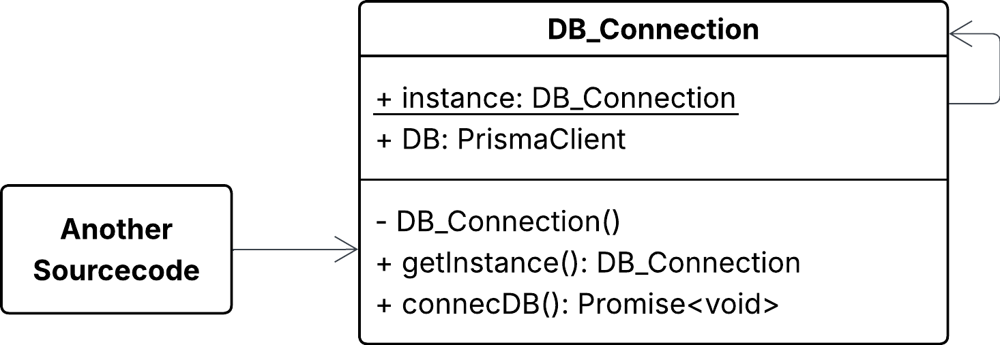

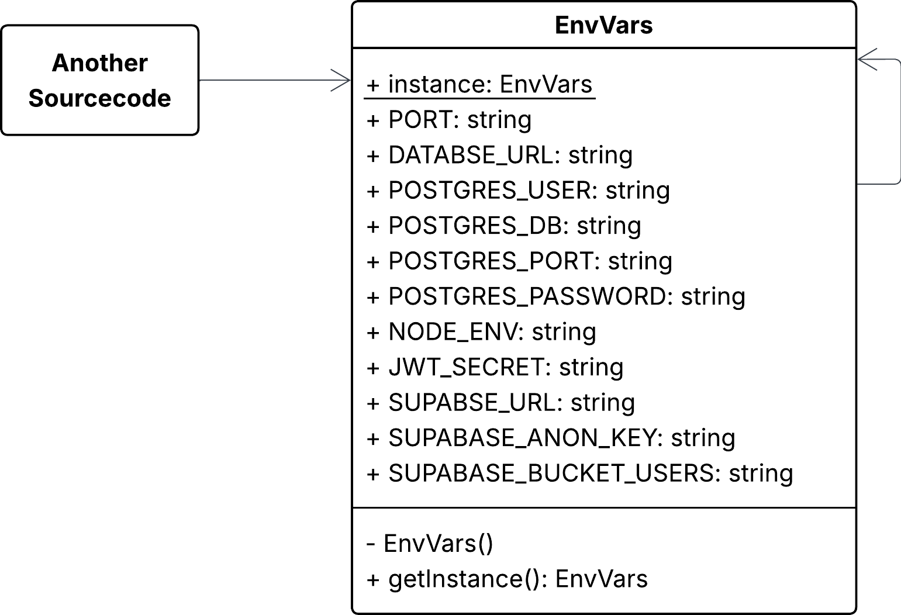

**Problema que resuelve**: Sin Singleton, cada módulo crearía su propia instancia de `PrismaClient` (agotando conexiones), las variables de entorno se validarían múltiples veces, y en desarrollo con HMR cada recarga crearía conexiones nuevas sin cerrar las anteriores.

**Implementación**: Se aplica en 3 recursos:

**1. Conexión a BD** (`db/db.ts`) — Singleton clásico con `#instance` privado:
```typescript
export class DB_Connection {
    static #instance: DB_Connection
    readonly DB: PrismaClient
    private constructor() {
        const pool = new pg.Pool({ connectionString: EnvVars.instance.DATABASE_URL })
        this.DB = global.prisma ?? new PrismaClient({ adapter: new PrismaPg(pool) })
        if (EnvVars.instance.NODE_ENV === 'development') global.prisma = this.DB
    }
    public static get instance(): DB_Connection {
        if (!DB_Connection.#instance) DB_Connection.#instance = new DB_Connection()
        return DB_Connection.#instance
    }
}
export default DB_Connection.instance.DB
```

**2. Variables de Entorno** (`store/enviroment.ts`) — Mismo patrón, valida todas las env vars al arranque (fail-fast con `exit(1)` si falta alguna):
```typescript
export class EnvVars {
    static #instance: EnvVars
    readonly PORT, DATABASE_URL, JWT_SECRET, SUPABASE_URL // ...
    private constructor() { /* valida cada variable o termina el proceso */ }
    public static get instance(): EnvVars { /* lazy init */ }
}
```

**3. Cliente Supabase** (`lib/supabase.ts`) — Singleton funcional con `global.supabase`.

**Beneficio**: Una sola conexión a PostgreSQL compartida, variables validadas una vez al arranque, y conexiones que sobreviven a HMR en desarrollo.

---

#### 3.1.2 Adapter

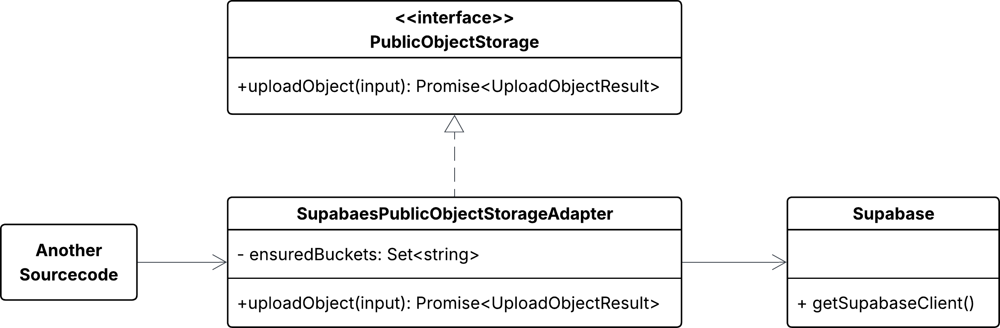

**Problema que resuelve**: El almacenamiento de archivos usa Supabase Storage actualmente, pero podría cambiar a AWS S3 u otro proveedor. Sin Adapter, todos los módulos que suben archivos dependerían directamente del SDK de Supabase.

**Implementación** (`adapters/storage/`):

**Interfaz Target** (`public-object-storage.ts`) — contrato que cualquier proveedor debe cumplir:
```typescript
export interface PublicObjectStorage {
    uploadObject(input: UploadObjectInput): Promise<UploadObjectResult>
}
```

**Adaptador Concreto** (`supabase-public-object-storage.adapter.ts`) — adapta el SDK de Supabase a la interfaz:
```typescript
export class SupabasePublicObjectStorageAdapter implements PublicObjectStorage {
    async uploadObject(input: UploadObjectInput): Promise<UploadObjectResult> {
        const supabase = getSupabaseClient()
        await supabase.storage.from(input.bucket).upload(input.path, input.data, { ... })
        const { data } = supabase.storage.from(input.bucket).getPublicUrl(input.path)
        return { publicUrl: data.publicUrl }
    }
}
```

**Factory** (`adapters/storage/index.ts`) — punto único de cambio para intercambiar proveedores:
```typescript
export function getPublicObjectStorage(): PublicObjectStorage {
    if (storage) return storage
    storage = new SupabasePublicObjectStorageAdapter() // Cambiar aquí para otro proveedor
    return storage
}
```

**Beneficio**: Para cambiar a AWS S3, solo se crea un nuevo adapter y se actualiza la factory. Los servicios nunca importan Supabase directamente.

---

### 3.2 Patrones en el Frontend

#### 3.2.1 Strategy

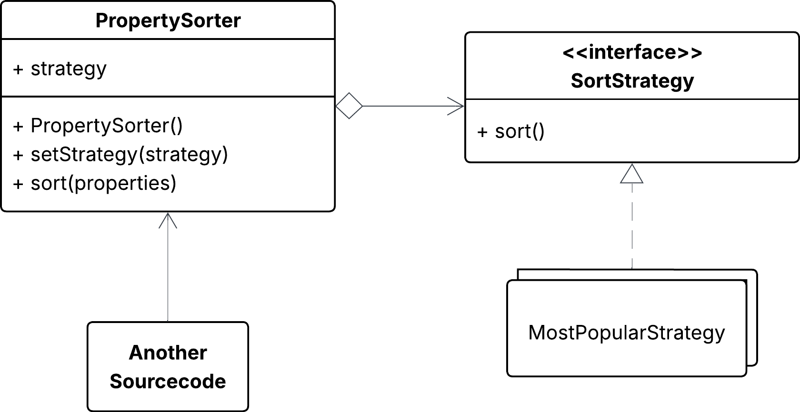

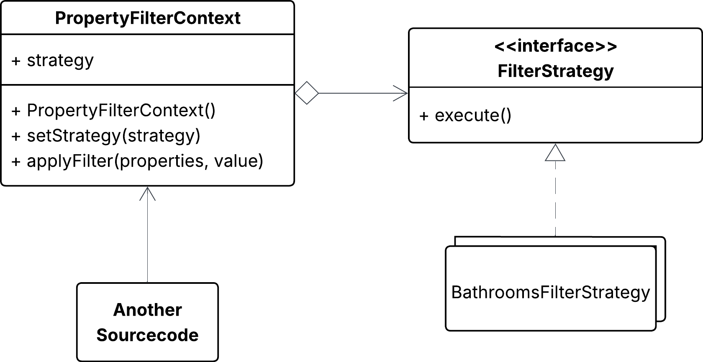

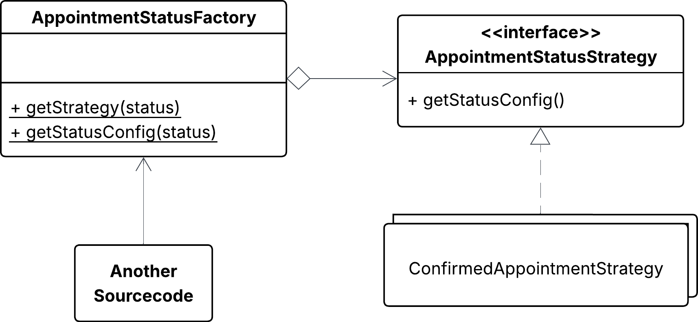

**Problema que resuelve**: El sistema necesita aplicar 8 filtros y 5 ordenamientos sobre propiedades. Sin Strategy, esto produciría funciones monolíticas imposibles de extender sin modificar código existente (viola Open/Closed).

**Implementación**:

**Filtros** (`strategies/PropertyFilters.js`): 8 estrategias con método `execute(properties, filterValue)` — `TextSearchStrategy`, `TypeFilterStrategy`, `MinPriceFilterStrategy`, `MaxPriceFilterStrategy`, `ZoneFilterStrategy`, `BedroomsFilterStrategy`, `BathroomsFilterStrategy`, `MinAreaFilterStrategy`. El contexto `PropertyFilterContext` permite cambiar estrategia en runtime:

```javascript
const filterContext = new PropertyFilterContext(TextSearchStrategy)
filterContext.setStrategy(TypeFilterStrategy)
result = filterContext.applyFilter(result, filters.propertyType)
```

**Ordenamiento** (`strategies/PropertySorters.js`): Clase base `SortStrategy` con 5 concretas: `MostRecentStrategy`, `PriceLowToHighStrategy`, `PriceHighToLowStrategy`, `AreaLowToHighStrategy`, `AreaHighToLowStrategy`. `getSortStrategy(sortType)` actúa como factory method.

**Estados de Citas** (`strategies/AppointmentStatus.strategy.js`): 4 estrategias (confirmada, pendiente agente, pendiente cliente, rechazada) que retornan configuración de UI. `AppointmentStatusFactory` selecciona la estrategia según el estado.

**Beneficio**: Agregar un nuevo filtro solo requiere crear una nueva estrategia, cero cambios en código existente.

---

#### 3.2.2 State

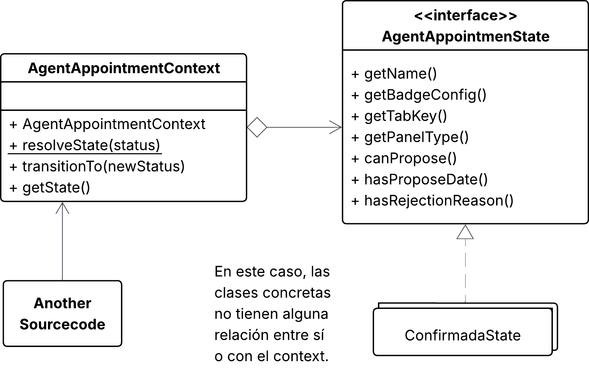

**Problema que resuelve**: Las citas tienen 4 estados (nueva solicitud, en espera, confirmada, cancelada) que determinan colores, acciones disponibles, tipo de panel y datos visibles. Sin State, habría condicionales `if/else` duplicados en cada componente.

**Implementación** (`context/AgentAppointmentState.js`):

Clase base `AgentAppointmentState` con métodos: `getName()`, `getBadgeConfig()`, `getTabKey()`, `getPanelType()`, `canPropose()`, `hasProposedDate()`, `hasRejectionReason()`.

**4 estados concretos**: `NuevaSolicitudState` (agente puede proponer horario), `EnEsperaState` (esperando respuesta del cliente), `ConfirmadaState` (cita confirmada), `CanceladaState` (rechazada, muestra motivo).

**Contexto con transiciones**:
```javascript
class AgentAppointmentContext {
  constructor(appointment) {
    this.state = AgentAppointmentContext.resolveState(appointment.status)
  }
  transitionTo(newStatus) {
    this.state = AgentAppointmentContext.resolveState(newStatus)
  }
}

// Uso
const context = new AgentAppointmentContext(appointment)
const config = context.state.getBadgeConfig()
if (context.state.canPropose()) { /* Mostrar formulario */ }
```

**Beneficio**: Agregar nuevo estado solo requiere crear una nueva clase sin tocar estados existentes.

---

#### 3.2.3 Command

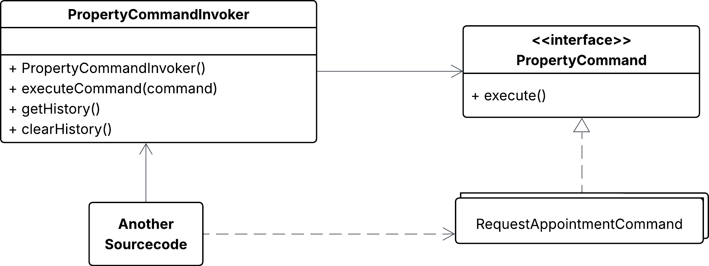
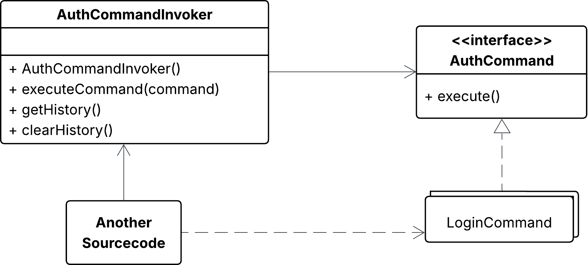
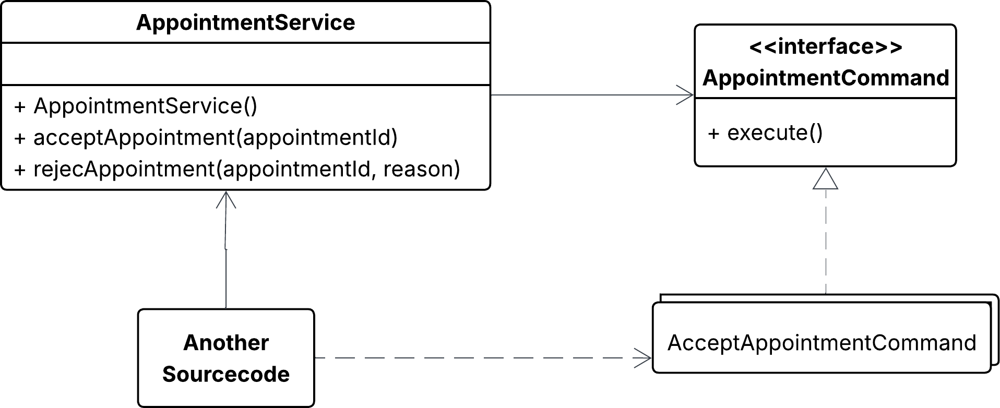
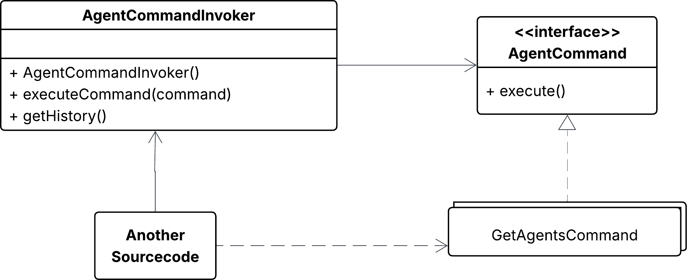

**Problema que resuelve**: Las operaciones CRUD necesitan encapsularse como objetos independientes para mantener historial de auditoría, desacoplar UI del servicio y permitir undo/redo futuro.

**Implementación** (`services/admin.service.js`):

Clase base `AgentCommand` con método abstracto `execute()`. **4 comandos concretos**: `GetAgentsCommand`, `CreateAgentCommand`, `UpdateAgentCommand`, `DeleteAgentCommand`.

El `AgentCommandInvoker` ejecuta comandos y mantiene historial:

```javascript
class AgentCommandInvoker {
  constructor() { this.history = [] }
  async executeCommand(command) {
    const result = await command.execute()
    this.history.push(command)
    return result
  }
}

// El servicio crea y ejecuta comandos a través del Invoker
const AgentService = {
  invoker: new AgentCommandInvoker(),
  async createAgent(agentData) {
    return await this.invoker.executeCommand(new CreateAgentCommand(API_URL, agentData))
  }
}
```

Este patrón se replica en los demás servicios del frontend: `auth.service.js` (Login, Register, Logout, ValidateToken), `property.service.js` (GetProperties, GetPropertyById, SearchProperties, ToggleFavorite, GetFavorites, RemoveFavorite, PropertyLookup, RequestAppointment), `appointment.service.js` (GetAppointments, AcceptAppointment, RejectAppointment), `profile.service.js` (GetProfile, UpdatePersonalInfo, UpdatePassword, UploadProfilePhoto), `agent/property.service.js` (GetProperties, CreateProperty, UpdateProperty, DeleteProperty) y `agent/appointment.service.js` (GetAgentAppointments, ProposeAppointment).

**Beneficio**: Historial de operaciones para auditoría, base para undo/redo, y testing simplificado.

---

## 4. Componentes y Estructura del Sistema

### 4.1 Arquitectura

El sistema sigue una **Arquitectura Modular por Capas (Layered Modular Architecture)**:

```
┌─────────────────────────────────────────────────┐
│                  Frontend (React)               │
│  Pages → Containers → Components → Strategies   │
├─────────────────────────────────────────────────┤
│              API REST (HTTP/JSON)               │
├─────────────────────────────────────────────────┤
│                Backend (Express)                │
│  Routes → Controllers → Services → DB/Adapters  │
├─────────────────────────────────────────────────┤
│            Base de Datos (PostgreSQL)           │
│               Prisma ORM (Schema)               │
└─────────────────────────────────────────────────┘
```

El backend se organiza en **módulos por dominio** (`auth`, `admin`, `agent`, `client`), donde cada módulo sigue internamente una separación en tres capas: **Route → Controller → Service**. Las dependencias externas se abstraen mediante interfaces (Adapter Pattern).

### 4.2 Frontend

**Stack Tecnológico**:
- **React 19.2**: Librería UI con componentes reactivos y Virtual DOM
- **Vite**: Bundler moderno con HMR instantáneo y builds optimizados
- **Tailwind CSS**: Framework utility-first para estilos responsivos
- **React Router DOM**: Navegación SPA declarativa sin recarga
- **Lucide React**: Librería de íconos moderna y tree-shakeable
- **React Hot Toast**: Sistema de notificaciones toast no intrusivas
- **date-fns**: Manipulación de fechas ligera y modular

**Arquitectura por Capas**:

| Capa | Responsabilidad | Ejemplos |
|------|----------------|----------|
| **Pages** | Vistas completas por ruta, composición de containers | `HomePage.jsx`, `SearchPage.jsx`, `ProfilePage.jsx` |
| **Containers** | Lógica de negocio, estado, llamadas API | `SearchContainer.jsx`, `LoginContainer.jsx`, `ProfileContainer.jsx` |
| **Components** | Presentación UI pura, sin estado complejo | `PropertyCard.jsx`, `FilterPanel.jsx`, `Button.jsx` |
| **Services** | Comunicación con backend, encapsulación de endpoints | `property.service.js`, `auth.service.js`, `appointment.service.js` |
| **Strategies** | Algoritmos intercambiables (filtros, ordenamiento) | `PropertyFilters.js`, `PropertySorters.js`, `AppointmentStatus.strategy.js` |
| **Context** | Estado global compartido con patrón State | `AgentAppointmentState.js` |


### 4.3 Backend

| Capa | Directorio | Descripción |
|------|-----------|-------------|
| **Módulos** | `src/modules/` | Módulos por dominio (auth, admin, agent, client), cada uno con route → controller → service |
| **Middleware** | `src/middleware/` | Autenticación JWT y validación con express-validator |
| **Adapters** | `src/adapters/` | Adaptadores para servicios externos (Supabase Storage) |
| **Lib** | `src/lib/` | Seguridad (bcrypt, JWT), cliente Supabase |
| **Store** | `src/store/` | Enums del dominio (UserType, PropertyType, PropertyState, InvitationState) y Singleton de variables de entorno (`EnvVars`) |
| **Utils** | `src/utils/` | Funciones utilitarias (respuestas HTTP, base64, env, strings) |
| **DB** | `src/db/` | Conexión a BD con Prisma + pool pg |

### 4.4 Estructura del Proyecto

#### 4.4.1 Estructura del Frontend

```
client/
├── public/images/              # Assets estáticos
├── src/
│   ├── components/             # Presentational por módulo
│   │   ├── admin/, agent/, appointments/, auth/, favorites/
│   │   ├── layout/, profile/, property/, search/, ui/
│   ├── containers/             # Lógica y estado
│   │   ├── admin/, agent/, appointments/, auth/, favorites/
│   │   ├── profile/, property/, search/
│   ├── context/                # Estado global (State pattern)
│   ├── pages/                  # 12 páginas con routing
│   │   ├── HomePage, LoginPage, RegisterPage, SearchPage
│   │   ├── PropertyDetailPage, FavoritesPage, ProfilePage
│   │   ├── AppointmentsPage, AdminAgentsPage
│   │   ├── AgentDashboardPage, AgentPropertiesPage, AgentAppointmentsPage
│   ├── services/               # API communication
│   │   ├── auth, property, appointment, profile, admin
│   │   ├── agent/ (3 servicios específicos)
│   ├── strategies/             # Strategy pattern
│   │   ├── PropertyFilters (8 estrategias)
│   │   ├── PropertySorters (5 estrategias)
│   │   └── AppointmentStatus (4 estados)
│   ├── App.jsx, main.jsx, index.css
├── vite.config.js, tailwind.config.js
```


#### 4.4.2 Estructura del Backend

```
server/
├── prisma/
│   ├── schema.prisma          # Definición del esquema de BD
│   └── migrations/            # Historial de migraciones
├── src/
│   ├── adapters/storage/      # Adapter Pattern (Supabase Storage)
│   ├── config/                # Configuración CORS
│   ├── db/                    # Conexión BD, seed, SQL
│   ├── generated/prisma/      # Cliente Prisma auto-generado
│   ├── lib/                   # Seguridad (bcrypt, JWT), Supabase client
│   ├── middleware/            # Auth middleware, validación
│   ├── modules/               # Módulos por dominio
│   │   ├── auth/              #   route.ts, controller.ts, service.ts
│   │   ├── admin/             #   route.ts, controller.ts, service.ts
│   │   ├── agent/             #   routes.ts, controller.ts, service.ts, dto.ts
│   │   └── client/            #   routes.ts, controller.ts, service.ts
│   ├── store/                 # Enums + EnvVars Singleton
│   ├── types/                 # Tipos globales (Express.d.ts)
│   ├── utils/                 # Utilidades (response, base64, env, strings)
│   └── index.ts               # Entry point del servidor
├── docker-compose.yml         # Orquestación Docker
├── Dockerfile                 # Imagen del backend
├── package.json
└── tsconfig.json
```

### 4.5 Base de Datos

#### 4.5.1 Modelo Relacional

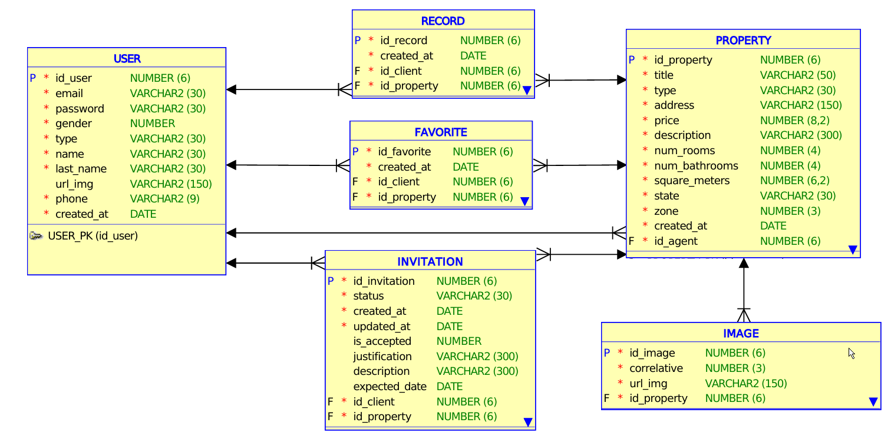

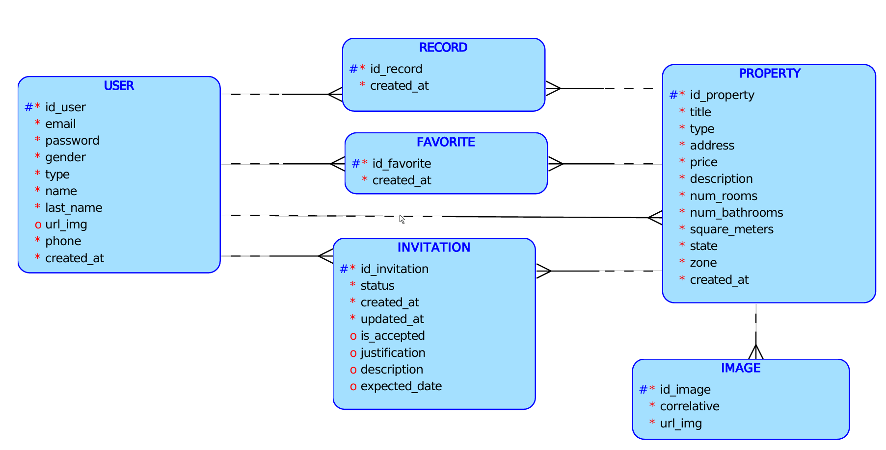

#### 4.5.2 Descripción de Tablas

| Tabla | Descripción | Campos principales |
|-------|-------------|-------------------|
| **USER** | Almacena todos los usuarios del sistema (clientes, agentes, administradores) diferenciados por el campo `type`. | `id_user`, `email` (único), `password` (hash bcrypt), `gender`, `type` (ADMIN/AGENT/CLIENT), `name`, `last_name`, `url_img`, `phone`, `created_at` |
| **property** | Almacena las propiedades inmobiliarias publicadas por los agentes. | `id_property`, `title`, `type` (HOUSE/APARTMENT/LAND/RETAIL SPACE), `address`, `price`, `description`, `num_rooms`, `num_bathrooms`, `square_meters`, `state` (AVAILABLE/SOLD/NOT AVAILABLE), `zone`, `created_at`, `id_agent` (FK → USER) |
| **favorite** | Relación muchos-a-muchos entre clientes y propiedades favoritas. | `id_favorite`, `created_at`, `id_client` (FK → USER), `id_property` (FK → property) |
| **image** | Almacena las imágenes asociadas a cada propiedad. | `id_image`, `correlative`, `url_img`, `id_property` (FK → property) |
| **invitation** | Gestiona las solicitudes de cita entre clientes y propiedades (y por ende, agentes). | `id_invitation`, `status` (PENDING/ACCEPTED/REJECTED/ACKNOWLEDGE), `created_at`, `updated_at`, `is_accepted`, `justification`, `description`, `expected_date`, `id_client` (FK → USER), `id_property` (FK → property) |
| **record** | Registro de historial de visitas/interacciones de clientes con propiedades. | `id_record`, `created_at`, `id_client` (FK → USER), `id_property` (FK → property) |

### 4.6 APIs y Endpoints

> **Nota sobre formato de respuesta:** Los endpoints de Auth, Admin y Agent (CRUD de propiedades, invitaciones) utilizan el helper `response_ok()`, por lo que sus respuestas reales están envueltas en `{ "ok": true, "data": { ... } }`. Los endpoints del módulo Client y algunos del Agent (dashboard, filter) retornan el JSON directamente sin este envoltorio. Los ejemplos de respuesta a continuación muestran el contenido del campo `data` (o el JSON directo según el caso).

#### Autenticación (`/api/auth`) — Público

##### `POST /api/auth/login`

**Request:**
```json
{
  "email": "example@gmail.com",
  "password": "password123"
}
```

**Response:**
```json
{
  "message": "Usuario Logueado.",
  "userId": 1,
  "token": "eyJhbGciOiJIUzI1NiIs..."
}
```

---

##### `POST /api/auth/register`

**Request:**
```json
{
  "name": "Juan",
  "last_name": "Pérez",
  "gender": true,
  "phone": 12345678,
  "email": "juan@gmail.com",
  "password": "password123",
  "url_img": "base64_string_or_url" | null
}
```

**Response:**
```json
{
  "message": "Usuario creado.",
  "userId": 1
}
```

---

##### `GET /api/auth/me`

**Request:** Token Bearer

**Response:**
```json
{
  "user": {
    "sub": "1",
    "email": "example@gmail.com",
    "type": "CLIENT"
  }
}
```

> Retorna el payload del token JWT del usuario autenticado. Útil para validar la sesión activa y obtener el rol del usuario.

---

#### Administrador (`/api/admin`) — Token Bearer requerido (Admin)

##### `GET /api/admin/agents`

**Request:** Token Bearer

**Response:**
```json
{
  "list": [
    {
      "id_user": 1,
      "email": "agente1@gmail.com",
      "name": "Carlos",
      "last_name": "García",
      "phone": 12345678,
      "url_img": "url_imagen",
      "type": "agent"
    }
  ]
}
```

---

##### `GET /api/admin/agents/:id`

**Request:** Token Bearer

**Response:**
```json
{
  "id_user": 1,
  "email": "agente1@gmail.com",
  "name": "Carlos",
  "last_name": "García",
  "phone": 12345678,
  "url_img": "url_imagen",
  "type": "agent"
}
```

---

##### `POST /api/admin/agents`

**Request:**
```json
{
  "email": "agente1@gmail.com",
  "name": "Carlos",
  "last_name": "García",
  "phone": 12345678,
  "url_img": "base64_imagen",
  "type": "agent"
}
```

**Response:**
```json
{ "message": "Agente creado con exito", "id_user": 1 }
```

---

##### `PUT /api/admin/agents/:id`

**Request:**
```json
{
  "id_user": 1,
  "email": "agente2@gmail.com",
  "name": "Carlos",
  "last_name": "García",
  "phone": 12345678,
  "url_img": "url_imagen",
  "type": "agent"
}
```

**Response:**
```json
{ "message": "Agente editado con exito", "id_user": 1 }
```

---

##### `DELETE /api/admin/agents/:id`

**Request:** Token Bearer

**Response:**
```json
{ "message": "Se ha eliminado el agente" }
```

---

#### Agente — Dashboard (`/api/agent`) — Token Bearer requerido (Agent)

##### `GET /api/agent/dashboard`

**Request:** Token Bearer

**Response:**
```json
{
  "total_properties": 12,
  "pending_appointments": 3,
  "sold_properties": 6,
  "most_searched": [
    { "type": "casa", "value": 50 }
  ],
  "most_offered_zones": [
    { "zone": 1, "value": 23 }
  ]
}
```

---

#### Agente — Gestión de Propiedades (`/api/agent`)

##### `POST /api/agent/properties`

**Request:**
```json
{
  "title": "Casa en Zona 10",
  "type": "Casa",
  "address": "Calle principal",
  "zone": "10",
  "price": 500000,
  "num_rooms": 3,
  "num_bathrooms": 2,
  "square_meters": 150.5,
  "state": "Disponible",
  "description": "Hermosa casa...",
  "images": ["base64_1", "base64_2"]
}
```

**Response:**
```json
{ "message": "Propiedad creada con exito", "id_property": 1 }
```

> Todos los campos son obligatorios. `images` debe contener mínimo 1 imagen. Tipos válidos: Casa, Apartamento, Terreno, Local Comercial. Estados válidos: Disponible, No Disponible, Vendido.

---

##### `POST /api/agent/filter`

**Request** (todos los campos opcionales):
```json
{
  "title": "Casa",
  "type": "APARTMENT",
  "price": 3435,
  "rooms": 4,
  "meter": 43,
  "bathrooms": 2,
  "is_ascendent_price": true,
  "is_ascendent_title": false
}
```

**Response:**
```json
{
  "list": [
    {
      "id": 3,
      "img": "url_imagen",
      "title": "Casa en Zona 10",
      "type": "apartamento",
      "zone": 3,
      "address": "2da avenida 53-56",
      "price": 400,
      "status": "available"
    }
  ]
}
```

---

##### `GET /api/agent/properties/:id`

**Request:** Token Bearer

**Response:**
```json
{
  "id_property": 1,
  "title": "Casa en Zona 10",
  "type": "Casa",
  "address": "Calle principal",
  "zone": "10",
  "price": 500000,
  "num_rooms": 3,
  "num_bathrooms": 2,
  "square_meters": 150.5,
  "state": "Disponible",
  "description": "Hermosa casa...",
  "created_at": "2026-02-04",
  "images": [
    { "id_image": 1, "url_img": "url_imagen_1" },
    { "id_image": 2, "url_img": "url_imagen_2" }
  ]
}
```

---

##### `PUT /api/agent/properties/:id`

**Request** (todos los campos opcionales, solo se actualizan los enviados):
```json
{
  "title": "Casa actualizada",
  "type": "Casa",
  "address": "Nueva dirección",
  "zone": "10",
  "price": 550000,
  "num_rooms": 4,
  "num_bathrooms": 2,
  "square_meters": 160.0,
  "state": "Vendido",
  "description": "Descripción actualizada",
  "images": ["base64_1", "base64_2"]
}
```

**Response:**
```json
{ "message": "Propiedad editada con exito", "id_property": 1 }
```

> Si se envía `images`, reemplaza todas las imágenes existentes.

---

##### `DELETE /api/agent/properties/:id`

**Request:** Token Bearer

**Response:**
```json
{ "message": "Se ha eliminado la propiedad" }
```

---

#### Agente — Gestión de Solicitudes/Citas (`/api/agent`)

##### `GET /api/agent/invitations/:type`

`:type` puede ser: `all`, `Pending`, `Accepted`, `Rejected`.

**Request:** Token Bearer

**Response:**
```json
{
  "list": [
    {
      "id_invitation": 1,
      "title": "Casa en Zona 10",
      "address": "Calle principal",
      "zone": "10",
      "price": 500000,
      "client_name": "Juan Pérez",
      "url_img": "url_imagen",
      "state": "Solicitud del cliente",
      "expected_date": null,
      "description": null,
      "justification": null,
      "created_at": "2026-02-01",
      "is_accepted": null
    },
    {
      "id_invitation": 2,
      "title": "Apartamento Centro",
      "address": "Avenida",
      "zone": "1",
      "price": 300000,
      "client_name": "María López",
      "url_img": "url_imagen",
      "state": "Cita agendada",
      "expected_date": "2026-02-10 14:00",
      "description": "Favor confirmar disponibilidad",
      "justification": null,
      "created_at": "2026-01-28",
      "is_accepted": true
    }
  ]
}
```

---

##### `POST /api/agent/invitations/:id/propose`

**Request:**
```json
{
  "expected_date": "2026-02-10 14:00",
  "description": "Favor confirmar su disponibilidad para esta fecha"
}
```

**Response:**
```json
{ "message": "Propuesta enviada exitosamente", "id_invitation": 1 }
```

> Solo se puede usar cuando el estado es "Solicitud del cliente". Ambos campos son obligatorios.

---

#### Cliente — Buscador de Propiedades (`/api/client`) — Token Bearer requerido (Client)

##### `POST /api/client/dashboard`

**Request** (todos los campos opcionales):
```json
{
  "title": "Casa",
  "type": "APARTMENT",
  "price": 3435,
  "rooms": 4,
  "meter": 43,
  "bathrooms": 2,
  "is_ascendent_price": true,
  "is_ascendent_title": false,
  "is_ascendente_date": true,
  "is_ascendente_area": true
}
```

**Response:**
```json
{
  "properties": [
    {
      "id_property": 2,
      "title": "La estancia",
      "price": 4500,
      "address": "La playa",
      "zone": "zona 13",
      "img": "base64",
      "num_rooms": 15,
      "num_bathrooms": 7,
      "square_meters": 49,
      "already_in_favorite": true
    }
  ]
}
```

---

##### `GET /api/client/property?id=31`

**Request:** Token Bearer

**Response:**
```json
{
  "id_property": 2,
  "title": "La estancia",
  "address": "La playa",
  "price": 4500,
  "description": "Descripción de la propiedad",
  "zone": "zona 13",
  "num_rooms": 15,
  "num_bathrooms": 7,
  "square_meters": 49,
  "type": "home",
  "image": ["base64_1", "base64_2"],
  "already_in_favorite": true,
  "estate_agent": "Roxana Valdeti"
}
```

---

##### `POST /api/client/property/favorite`

**Request:**
```json
{ "id_property": 2 }
```

**Response:**
```json
{ "message": "Propiedad guardada en favoritos" }
```

---

##### `POST /api/client/property/lookup`

**Request:**
```json
{ "id_property": 2 }
```

**Response:**
```json
{ "message": "Informacion guardada" }
```

> Registra que el cliente visitó la propiedad (alimenta estadísticas del dashboard del agente).

---

#### Cliente — Perfil (`/api/client`)

##### `GET /api/client/profile`

**Request:** Token Bearer

**Response:**
```json
{
  "name": "Daniel",
  "lastname": "Godinez",
  "gender": true,
  "phone": 333333333,
  "email": "example@gmail.com",
  "img": "base64"
}
```

---

##### `PUT /api/client/profile`

**Request:**
```json
{
  "name": "Daniel",
  "lastname": "Godinez",
  "gender": "male",
  "phone": 333333333,
  "email": "example@gmail.com",
  "img": "base64" | null,
  "password": "nueva_contraseña"
}
```

**Response:**
```json
{ "message": "Datos de perfil actualizados exitosamente" }
```

---

#### Cliente — Mis Citas (`/api/client`)

##### `GET /api/client/appointment/{all|finalized|pending|acknowledge}`

Cada filtro es una ruta estática independiente: `/appointment/all`, `/appointment/finalized`, `/appointment/pending`, `/appointment/acknowledge`. Todas retornan la misma estructura, solo cambia el filtro aplicado.

**Request:** Token Bearer

**Response:**
```json
{
  "appointments": [
    {
      "id_property": 2,
      "title": "La estancia",
      "address": "La playa",
      "id_agent": 4,
      "agent_name": "Nombre Agente",
      "img": "base64",
      "status": "confirmed",
      "description": "Cita programada para el 12...",
      "expected_date": "2026-02-12 10:00",
      "is_accepted": true,
      "justification": null
    },
    {
      "id_property": 3,
      "title": "Local Comercial",
      "address": "Zona Viva",
      "id_agent": 4,
      "agent_name": "Nombre Agente",
      "img": "base64",
      "status": "acknowledge",
      "description": "Te espero a las 12",
      "expected_date": "2026-02-15 12:00",
      "is_accepted": null,
      "justification": null
    }
  ]
}
```

> Estados posibles: `confirmed` (aceptada), `rejected` (rechazada, incluye `justification`), `pending` (por confirmar el agente), `acknowledge` (por confirmar el cliente).

---

##### `POST /api/client/appointment/acknowledge`

**Request:**
```json
{
  "id_appointment": 15,
  "status": "accepted" | "rejected",
  "justification": null | "Motivo del rechazo"
}
```

**Response:**
```json
{ "message": "Cita confirmada" }
```

---

#### Cliente — Favoritos (`/api/client`)

##### `GET /api/client/properties/favorite`

**Request:** Token Bearer

**Response:**
```json
{
  "total": 4,
  "favorites": [
    {
      "id_favorite": 4,
      "title": "USAC",
      "price": 50000,
      "num_rooms": 15,
      "num_bathrooms": 7,
      "square_meters": 49,
      "address": "cerca de cayala, octava avenida...",
      "id_property": 3
    }
  ]
}
```

---

##### `DELETE /api/client/properties/favorite?id=31`

**Request:** Token Bearer

**Response:**
```json
{ "message": "Propiedad eliminada de favoritos" }
```

---

#### Cliente — Zonas (`/api/client`)

##### `GET /api/client/zones`

**Request:** Token Bearer

**Response:**
```json
{ "zones": ["zona 1", "zona 10", "zona 13"] }
```

### 4.7 Seguridad

| Mecanismo | Descripción |
|-----------|-------------|
| **Autenticación JWT** | Tokens firmados con `jsonwebtoken`, expiración de 7 días, payload contiene `sub` (id), `email` y `type` (rol). Se envían como Bearer token en el header `Authorization`. |
| **Hashing de contraseñas** | bcrypt con 10 salt rounds. Las contraseñas nunca se almacenan en texto plano. |
| **Middleware de autenticación** | `authMiddleware` extrae y verifica el Bearer token en cada request protegido. Inyecta `req.user` con el payload decodificado. |
| **Validación de entrada** | `express-validator` valida todos los campos de entrada en las rutas (email válido, longitud de contraseña, formatos de datos). |
| **CORS** | Configuración restrictiva: solo permite orígenes autorizados (localhost en desarrollo, dominios de producción), con soporte para credentials. |
| **Variables de entorno** | Secrets (JWT_SECRET, DATABASE_URL, SUPABASE_KEY) se gestionan mediante archivos `.env` y nunca se incluyen en el repositorio. |

### 4.8 Despliegue

El despliegue se realiza mediante Docker Compose:

```yaml
# docker-compose.yml
services:
  postgres-db:    # PostgreSQL 15.3 con healthcheck
  backend:        # Node.js 24 Alpine, depende de postgres-db
```

**Pasos**: `docker-compose up --build` → el servicio backend ejecuta un `command: sh -c "..."` que espera a que PostgreSQL esté listo, ejecuta migraciones (`prisma migrate deploy`), seed (`npm run db:seed`) y arranca el servidor (`npm run dev`).

---

## 5. Diagramas de Casos de Uso

### 5.1 Actores del Sistema

| Actor | Tipo | Descripción | Casos de Uso Principales |
|-------|------|-------------|--------------------------|
| **Cliente** | Primario / Externo | Persona que se registra para buscar propiedades, guardar favoritos y solicitar citas con agentes inmobiliarios. Se registra con nombre completo, correo electrónico (único), contraseña y fotografía (opcional). | CDU002 (Solicitar cita, aceptar/rechazar horario), CDU004 (Buscar y filtrar propiedades, editar perfil, gestionar favoritos), CDU005 (Registro, inicio de sesión) |
| **Agente Inmobiliario** | Primario / Externo | Profesional del sector inmobiliario encargado de publicar, actualizar y dar mantenimiento a las propiedades en la plataforma. Gestiona citas con clientes y tiene acceso a estadísticas de rendimiento. | CDU001 (CRUD propiedades, gestionar tipos de inmueble, consultar dashboard/estadísticas), CDU002 (Proponer horarios, gestionar citas), CDU005 (Inicio de sesión) |
| **Administrador** | Primario / Interno | Usuario con privilegios administrativos cuya función principal es gestionar a los agentes inmobiliarios del sistema. Ingresa mediante credenciales (correo y contraseña). | CDU003 (CRUD de agentes inmobiliarios), CDU005 (Inicio de sesión) |
| **Sistema** | Secundario / Interno | La plataforma HomeFinder Pro que procesa solicitudes, valida datos, gestiona notificaciones y mantiene la integridad de la información. | Participa en todos los CDU como el componente que procesa y responde a las acciones de los actores primarios. |

### 5.2 Diagrama de Casos de Uso de Alto Nivel (High-Level)

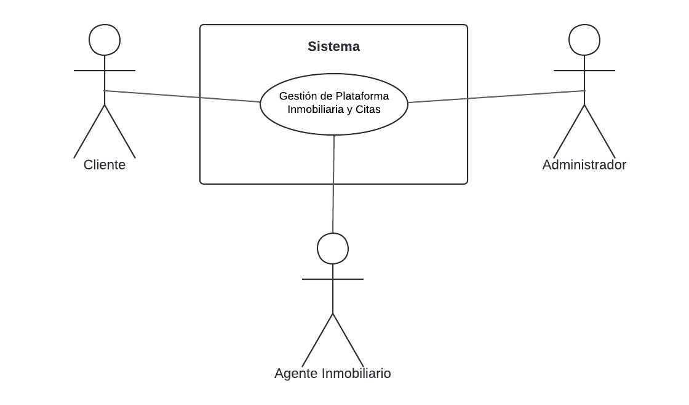

- **CDU001**: Gestión de Propiedades Inmobiliarias
- **CDU002**: Solicitud y Negociación de Citas
- **CDU003**: Gestión de Usuarios/Agentes
- **CDU004**: Gestión de Perfil y Búsqueda
- **CDU005**: Autenticación y Autorización

### 5.3 Descomposición de Casos de Uso

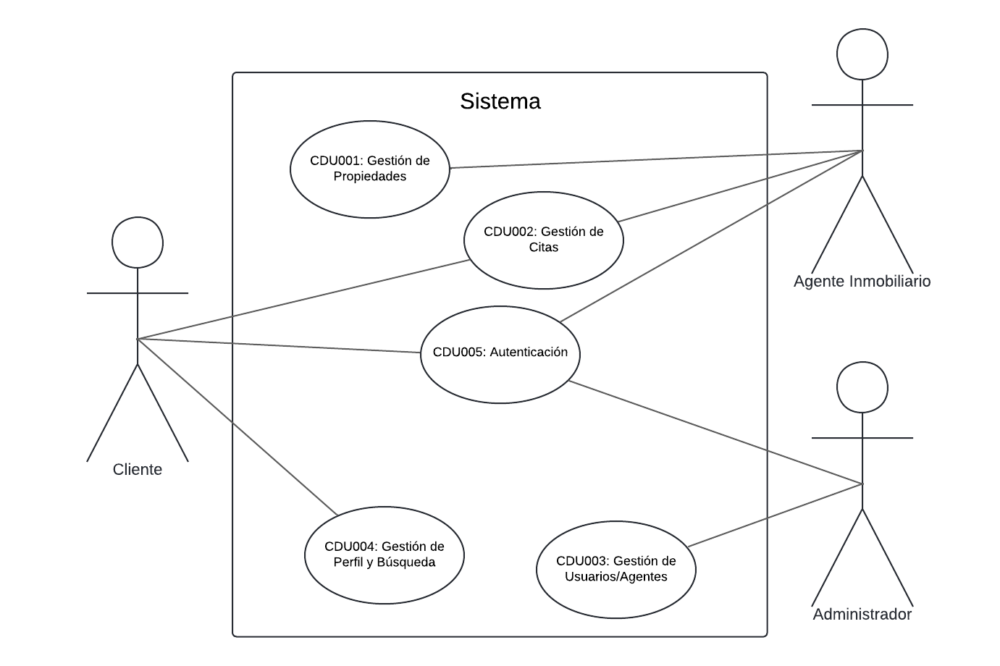

**CDU001 - Gestión de Propiedades**:
- CDU001.0: Gestionar Propiedades
- CDU001.1: Crear Propiedad
- CDU001.2: Actualizar Propiedad
- CDU001.3: Eliminar Propiedad
- CDU001.4: Consultar Estadísticas
- CDU001.5: Gestionar Tipo de Inmuebles (categorías predefinidas: Casa, Apartamento, Terreno, Local Comercial)
- CDU001.6: Seleccionar Tipo de Inmueble al crear propiedad
- CDU001.7: Validar Tipo de Inmueble
- CDU001.8: Filtrar por Tipo de Inmueble
- CDU001.9: Visualizar Propiedades

**CDU002 - Gestión de Citas**:
- CDU002.0: Solicitar Cita
- CDU002.1: Proponer Horarios de Cita
- CDU002.2: Aceptar/Rechazar Horario

**CDU003 - Gestión de Usuarios/Agentes**:
- CDU003.0: Visualizar Agentes
- CDU003.1: Gestionar Agentes
- CDU003.2: Crear Agente
- CDU003.3: Actualizar Agente
- CDU003.4: Eliminar Agente

**CDU004 - Gestión de Perfil y Búsqueda**:
- CDU004.0: Visualizar Propiedades
- CDU004.1: Filtrar Propiedades
- CDU004.2: Editar Información Personal
- CDU004.3: Gestionar Perfil

**CDU005 - Autenticación y Autorización**:
- CDU005.0: Registrar Cliente
- CDU005.1: Iniciar Sesión
- CDU005.2: Cerrar Sesión

### 5.4 Especificación Detallada de Casos de Uso

A continuación se presenta la especificación detallada de cada caso de uso expandido.

---

#### 5.4.1 CDU001 - Gestión de Propiedades Inmobiliarias

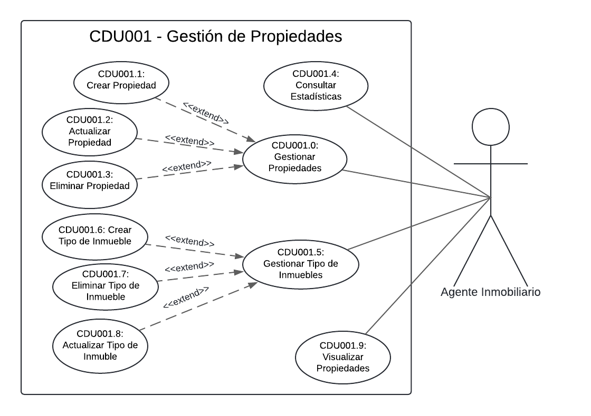

| Campo | Descripción |
|-------|-------------|
| **Nombre** | Gestión de Propiedades Inmobiliarias |
| **Código** | CDU001 |
| **Actores** | Agente Inmobiliario |
| **Descripción** | Permite al agente administrar el ciclo de vida de las propiedades (creación, edición, eliminación) y consultar el rendimiento de las mismas mediante estadísticas. |
| **Precondiciones** | El Agente debe haber iniciado sesión (CDU005). |
| **Post Condiciones** | El catálogo de propiedades queda actualizado en la base de datos. |
| **Flujo Principal** | 1. El Agente selecciona "Gestionar Propiedades" (CDU001.0).<br>2. El Sistema muestra el listado de inmuebles asignados.<br>3. El Agente visualiza la información general.<br>4. El Agente finaliza la gestión. |
| **Flujos Alternos** | **FA1: Crear Propiedad (CDU001.1)**<br>1. El Agente selecciona "Nueva Propiedad".<br>2. Ingresa datos (título, dirección, precio, descripción, tipo, habitaciones, baños, m², zona) y fotos.<br>3. Sistema valida campos obligatorios y formatos.<br>4. Sistema almacena la propiedad e imágenes.<br><br>**FA2: Actualizar Propiedad (CDU001.2)**<br>1. El Agente selecciona una propiedad existente.<br>2. Modifica los datos necesarios.<br>3. Sistema valida y actualiza.<br><br>**FA3: Eliminar Propiedad (CDU001.3)**<br>1. El Agente selecciona eliminar propiedad.<br>2. Sistema solicita confirmación.<br>3. Sistema elimina la propiedad y sus imágenes/favoritos/citas asociadas (cascade).<br><br>**FA4: Consultar Estadísticas (CDU001.4)**<br>1. El Agente selecciona ver dashboard.<br>2. Sistema muestra Top 3 tipos de inmuebles más buscados y Top 5 zonas con mayor oferta.<br><br>**FA5: Gestión de Tipos (CDU001.5)**<br>1. Los tipos de inmueble están definidos como categorías predeterminadas en el sistema: Casa, Apartamento, Terreno, Local Comercial.<br>2. El Agente selecciona el tipo correspondiente al crear o editar una propiedad.<br>3. El sistema valida que el tipo sea uno de los valores permitidos.<br><br>**FA6: Visualizar Propiedades (CDU001.9)**<br>1. El Agente visualiza el listado completo de sus propiedades con filtros por tipo, precio y características.<br>2. Sistema muestra información resumida de cada propiedad. |
| **Reglas de Negocio** | RN1: Solo el agente propietario puede editar o eliminar una propiedad.<br>RN2: Toda propiedad debe tener al menos título, dirección, precio, tipo y descripción.<br>RN3: Los tipos de inmueble válidos son: Casa, Apartamento, Terreno y Local Comercial.<br>RN4: El precio debe ser un valor numérico positivo con máximo 2 decimales.<br>RN5: Al eliminar una propiedad se eliminan en cascada sus imágenes, favoritos, citas y registros asociados.<br>RN6: Las estadísticas del dashboard se calculan en base a los registros de búsqueda (tabla `record`). |
| **Reglas de Calidad** | RC1: La creación/actualización de propiedad debe completarse en menos de 3 segundos (excluyendo carga de imágenes).<br>RC2: El dashboard de estadísticas debe cargar en menos de 2 segundos.<br>RC3: Las imágenes de propiedades deben almacenarse en un servicio externo (Supabase Storage) con URL pública accesible.<br>RC4: Los campos deben validarse tanto en frontend como en backend para garantizar integridad. |

---

#### 5.4.2 CDU002 - Solicitud y Negociación de Citas

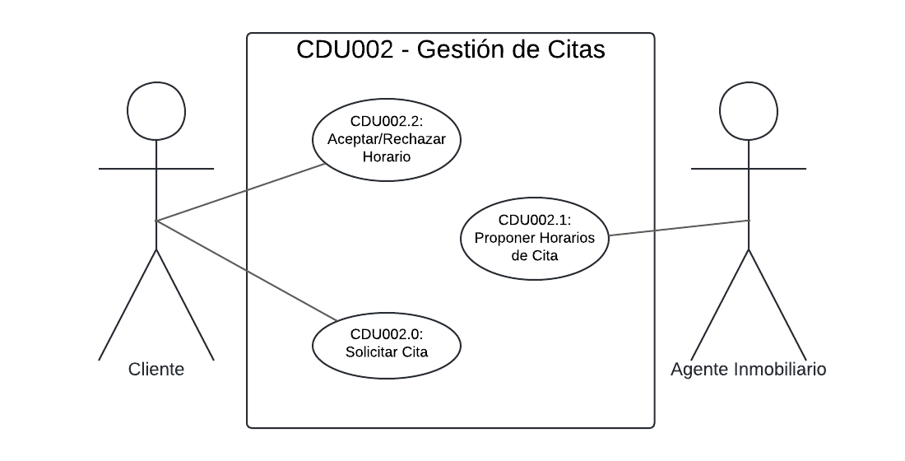

| Campo | Descripción |
|-------|-------------|
| **Nombre** | Solicitud y Negociación de Citas |
| **Código** | CDU002 |
| **Actores** | Cliente (Iniciador), Agente Inmobiliario |
| **Descripción** | Gestiona el flujo de agendamiento de visitas, permitiendo al cliente solicitar una hora, y al agente aceptar o proponer una contraoferta. |
| **Precondiciones** | El Cliente debe estar registrado e haber iniciado sesión. La propiedad debe estar en estado "AVAILABLE". |
| **Post Condiciones** | La cita queda en estado "ACCEPTED", "REJECTED" o "PENDING" en la tabla `invitation`. |
| **Flujo Principal** | 1. El Cliente solicita una cita para una propiedad (CDU002.0).<br>2. El Sistema crea una invitación con estado "PENDING".<br>3. El Agente propietario de la propiedad revisa la solicitud.<br>4. El Agente acepta el horario propuesto (CDU002.2).<br>5. El Sistema actualiza el estado a "ACCEPTED". |
| **Flujos Alternos** | **FA1: Proponer Nuevo Horario (CDU002.1)**<br>1. El Agente no acepta la hora inicial y propone una nueva fecha/hora (`expected_date`).<br>2. El Cliente recibe la propuesta con la descripción del agente.<br>3. El Cliente Acepta o Rechaza (CDU002.2).<br><br>**FA2: Cliente Rechaza Horario Propuesto**<br>1. El Cliente rechaza el horario propuesto por el agente.<br>2. El Sistema solicita al cliente ingresar un motivo (`justification`).<br>3. El Sistema actualiza el estado a "REJECTED" y almacena la justificación.<br>4. El Agente puede visualizar el motivo y proponer un nuevo horario. |
| **Reglas de Negocio** | RN1: Solo se pueden solicitar citas para propiedades en estado "AVAILABLE".<br>RN2: El estado de una invitación sigue el ciclo: PENDING → ACCEPTED/REJECTED/ACKNOWLEDGE.<br>RN3: Al rechazar una cita (tanto cliente como agente) se debe proporcionar una justificación obligatoria (máximo 300 caracteres).<br>RN4: El agente puede proponer un horario alternativo mediante el campo `expected_date`.<br>RN5: Un cliente puede tener múltiples solicitudes de cita para diferentes propiedades. |
| **Reglas de Calidad** | RC1: Las solicitudes de cita deben procesarse y ser visibles para el agente en menos de 2 segundos.<br>RC2: El cambio de estado de una cita debe reflejarse inmediatamente en la interfaz de ambos actores.<br>RC3: El campo de justificación debe permitir texto descriptivo de hasta 300 caracteres. |

---

#### 5.4.3 CDU003 - Gestión de Usuarios/Agentes

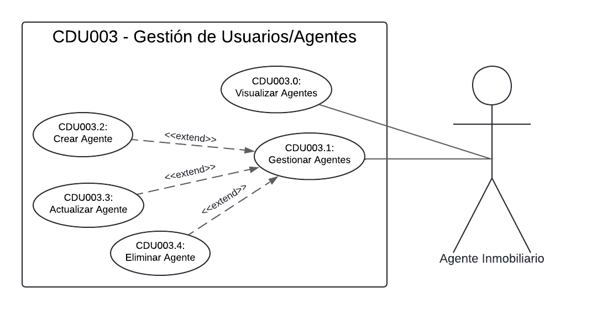

| Campo | Descripción |
|-------|-------------|
| **Nombre** | Gestión de Usuarios/Agentes |
| **Código** | CDU003 |
| **Actores** | Administrador |
| **Descripción** | Permite al Administrador la gestión completa de agentes inmobiliarios en el sistema, incluyendo la creación, visualización, actualización y eliminación de cuentas de agentes. |
| **Precondiciones** | El Administrador debe haber iniciado sesión (CDU005) y su tipo de usuario debe ser "ADMIN". |
| **Post Condiciones** | El catálogo de agentes queda actualizado en la base de datos. Los agentes creados pueden acceder al sistema con sus credenciales. |
| **Flujo Principal** | 1. El Administrador accede al módulo de Gestión de Agentes (CDU003.1).<br>2. El Sistema muestra el listado de agentes registrados (CDU003.0).<br>3. El Administrador visualiza la información de los agentes.<br>4. El Administrador finaliza la gestión. |
| **Flujos Alternos** | **FA1: Crear Agente (CDU003.2)**<br>1. El Administrador selecciona "Nuevo Agente".<br>2. Ingresa los datos del agente (nombre, apellido, correo, teléfono, género, contraseña, fotografía opcional).<br>3. Sistema valida que el correo no exista.<br>4. Sistema crea la cuenta con tipo "AGENT" y hash de contraseña.<br><br>**FA2: Actualizar Agente (CDU003.3)**<br>1. El Administrador selecciona un agente existente.<br>2. Modifica los datos necesarios.<br>3. Sistema valida y actualiza la información.<br><br>**FA3: Eliminar/Desactivar Agente (CDU003.4)**<br>1. El Administrador selecciona eliminar agente.<br>2. Sistema solicita confirmación.<br>3. Sistema elimina la cuenta del agente y sus propiedades asociadas (cascade). |
| **Reglas de Negocio** | RN1: Solo los usuarios con tipo "ADMIN" pueden acceder a la gestión de agentes.<br>RN2: El correo electrónico del agente debe ser único en el sistema.<br>RN3: La contraseña del agente debe cumplir con los requisitos mínimos de seguridad (mínimo 6 caracteres).<br>RN4: Al eliminar un agente se eliminan en cascada todas sus propiedades, imágenes, favoritos y citas asociadas.<br>RN5: Un agente recién creado puede iniciar sesión inmediatamente con las credenciales asignadas. |
| **Reglas de Calidad** | RC1: El listado de agentes debe cargarse en menos de 2 segundos.<br>RC2: La creación de un agente debe completarse en menos de 3 segundos.<br>RC3: Se debe solicitar confirmación antes de eliminar un agente para prevenir eliminaciones accidentales. |

---

#### 5.4.4 CDU004 - Gestión de Perfil y Búsqueda

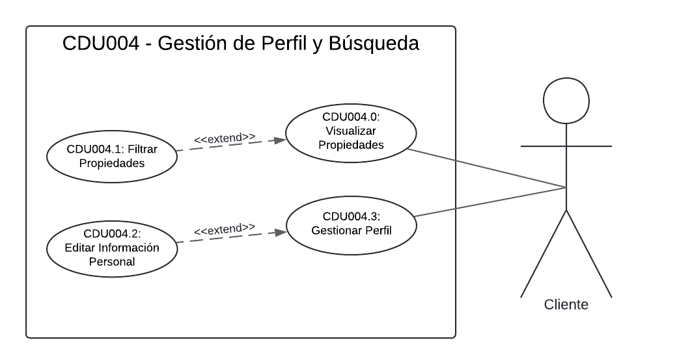

| Campo | Descripción |
|-------|-------------|
| **Nombre** | Gestión de Perfil y Búsqueda |
| **Código** | CDU004 |
| **Actores** | Cliente |
| **Descripción** | Permite al cliente gestionar su información personal y realizar búsquedas avanzadas de propiedades utilizando múltiples filtros y criterios de ordenamiento para encontrar inmuebles que se ajusten a sus necesidades. |
| **Precondiciones** | El Cliente debe haber iniciado sesión (CDU005). |
| **Post Condiciones** | La información del perfil del cliente queda actualizada. El historial de búsquedas se registra en la tabla `record`. |
| **Flujo Principal** | 1. El Cliente accede a su perfil o módulo de búsqueda.<br>2. El Sistema muestra las opciones disponibles.<br>3. El Cliente selecciona Visualizar Propiedades (CDU004.0) o Gestionar Perfil (CDU004.3).<br>4. El Sistema procesa la solicitud. |
| **Flujos Alternos** | **FA1: Filtrar Propiedades (CDU004.1)**<br>1. El Cliente selecciona "Buscar Propiedades".<br>2. El Sistema muestra el panel de filtros con opciones: tipo de inmueble, rango de precio (mín-máx), zona, número de habitaciones, número de baños, rango de área (mín-máx).<br>3. El Cliente aplica uno o más filtros utilizando el patrón Strategy.<br>4. El Sistema aplica las estrategias de filtrado secuencialmente y muestra los resultados.<br>5. El Cliente puede ordenar resultados (reciente, precio asc/desc, área, popularidad).<br>6. El Cliente puede agregar propiedades a favoritos.<br><br>**FA2: Editar Información Personal (CDU004.2)**<br>1. El Cliente selecciona "Editar Perfil".<br>2. Modifica sus datos personales (nombre, apellido, correo, teléfono, fotografía).<br>3. Sistema valida los cambios (correo único, formatos correctos).<br>4. Sistema actualiza la información del perfil.<br><br>**FA3: Visualizar Propiedades (CDU004.0)**<br>1. El Cliente visualiza el catálogo completo de propiedades disponibles.<br>2. Sistema muestra información resumida (título, precio, tipo, zona, imagen principal).<br>3. El Cliente puede seleccionar una propiedad para ver detalles completos. |
| **Reglas de Negocio** | RN1: Los filtros se aplican de forma acumulativa (AND lógico entre filtros activos).<br>RN2: La búsqueda por texto busca coincidencias en título, descripción, dirección y zona.<br>RN3: Solo se muestran propiedades en estado "AVAILABLE".<br>RN4: Cada vista de propiedad se registra en la tabla `record` para alimentar las estadísticas del dashboard del agente.<br>RN5: Un cliente puede agregar/quitar propiedades de favoritos sin límite.<br>RN6: El correo electrónico es el identificador único del usuario y no puede duplicarse al actualizar el perfil. |
| **Reglas de Calidad** | RC1: Los resultados de búsqueda deben mostrarse en menos de 2 segundos.<br>RC2: Los filtros deben aplicarse en el cliente con la estrategia correspondiente sin necesidad de recargar la página.<br>RC3: La actualización de perfil debe confirmar los cambios al usuario con una notificación visual (toast).<br>RC4: La interfaz de búsqueda debe ser responsiva y funcionar correctamente en dispositivos móviles. |

---

#### 5.4.5 CDU005 - Autenticación y Autorización

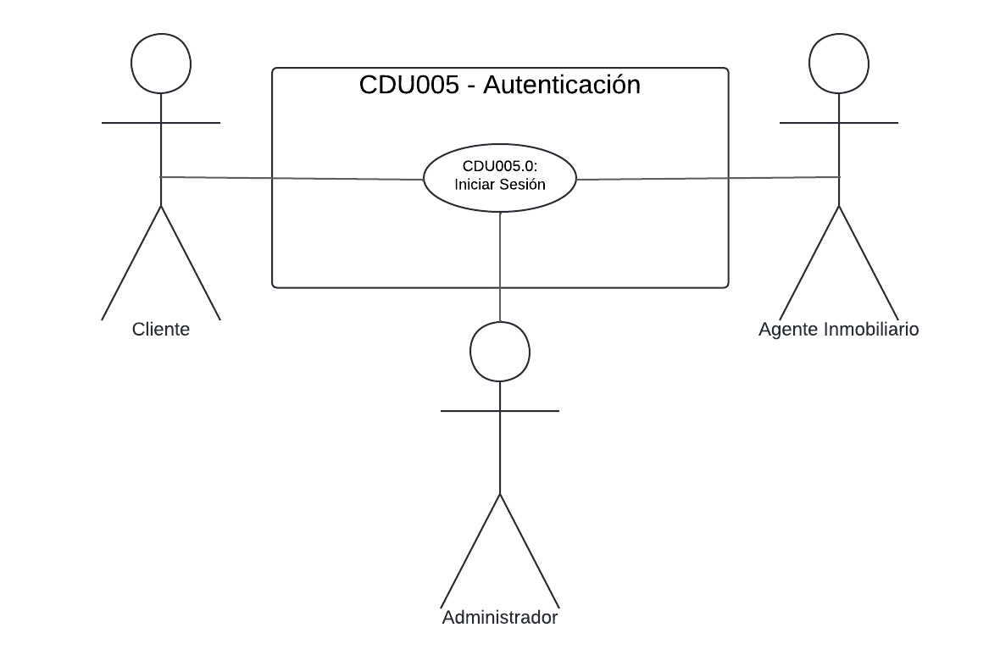

| Campo | Descripción |
|-------|-------------|
| **Nombre** | Autenticación y Autorización |
| **Código** | CDU005 |
| **Actores** | Cliente, Agente Inmobiliario, Administrador |
| **Descripción** | Gestiona el registro de nuevos clientes y el inicio/cierre de sesión de todos los usuarios del sistema, asegurando que cada usuario acceda únicamente a las funcionalidades correspondientes a su rol. |
| **Precondiciones** | Para registro: el correo electrónico no debe estar registrado. Para login: el usuario debe tener una cuenta existente. |
| **Post Condiciones** | Registro: se crea una nueva cuenta de tipo "CLIENT" y se emite un JWT. Login: se emite un JWT válido por 7 días. Logout: se invalida la sesión del cliente. |
| **Flujo Principal** | 1. El usuario accede a la página de inicio de sesión.<br>2. Ingresa su correo electrónico y contraseña.<br>3. El Sistema valida las credenciales contra la base de datos (comparación bcrypt).<br>4. El Sistema genera un token JWT con el payload (sub, email, type).<br>5. El Sistema retorna el token y los datos del usuario (sin contraseña).<br>6. El Sistema redirige al usuario a la vista correspondiente según su rol. |
| **Flujos Alternos** | **FA1: Registrar Cliente (CDU005.0)**<br>1. El usuario selecciona "Crear cuenta".<br>2. Ingresa: nombre, apellido, correo electrónico, contraseña (mín. 6 caracteres), teléfono (8-9 dígitos), género.<br>3. Opcionalmente adjunta una fotografía de perfil (base64 o URL).<br>4. Sistema valida que el correo no esté registrado.<br>5. Sistema hashea la contraseña con bcrypt (10 rounds) y crea la cuenta con tipo "CLIENT".<br>6. Si se adjuntó foto, se sube a Supabase Storage y se almacena la URL pública.<br>7. Sistema emite JWT y retorna los datos del usuario.<br><br>**FA2: Credenciales Inválidas**<br>1. El usuario ingresa email/contraseña incorrectos.<br>2. Sistema responde con error 401 "Invalid credentials".<br>3. Se muestra mensaje de error en la interfaz.<br><br>**FA3: Correo ya Registrado**<br>1. Durante el registro, el correo ya existe en la base de datos.<br>2. Sistema responde con error 400 "Email already registered".<br>3. Se muestra mensaje indicando que el correo ya está en uso. |
| **Reglas de Negocio** | RN1: El correo electrónico debe ser único en todo el sistema (validado con constraint UNIQUE en BD).<br>RN2: Las contraseñas se almacenan hasheadas con bcrypt (10 salt rounds), nunca en texto plano.<br>RN3: El registro público solo crea cuentas de tipo "CLIENT"; los agentes son creados por el administrador (CDU003).<br>RN4: El token JWT tiene una vigencia de 7 días y contiene: id de usuario (sub), email y tipo de usuario (type).<br>RN5: Todos los endpoints protegidos requieren un Bearer token válido en el header Authorization. |
| **Reglas de Calidad** | RC1: El proceso de registro/login debe completarse en menos de 2 segundos.<br>RC2: Los mensajes de error deben ser claros y específicos (campo inválido, correo duplicado, credenciales incorrectas).<br>RC3: El formulario de registro debe validar campos en tiempo real antes de enviar al servidor.<br>RC4: La contraseña no debe ser visible por defecto; se ofrece un toggle para mostrar/ocultar. |

---

## 6. Requerimientos del Sistema

### 6.1 Requerimientos Funcionales

| ID | Requerimiento | Descripción | Prioridad | CDU Relacionado | Usuario |
|----|--------------|-------------|-----------|-----------------|---------|
| RF001 | Registro de clientes | El sistema debe permitir el registro de nuevos clientes con: nombre completo, correo electrónico (único), contraseña y fotografía (opcional). | Alta | CDU005.0 | Cliente |
| RF002 | Inicio de sesión | El sistema debe permitir que todos los usuarios (Cliente, Agente, Administrador) inicien sesión con correo electrónico y contraseña. | Alta | CDU005.1 | Cliente, Agente Inmobiliario, Administrador |
| RF003 | Autenticación JWT | El sistema debe emitir un token JWT al iniciar sesión o registrarse, que se utiliza para autenticar las solicitudes posteriores. | Alta | CDU005 | Cliente, Agente Inmobiliario, Administrador |
| RF004 | Cierre de sesión | El sistema debe permitir al usuario cerrar sesión, invalidando su sesión actual en el cliente. | Media | CDU005.2 | Cliente, Agente Inmobiliario, Administrador |
| RF005 | Crear propiedad | El sistema debe permitir al agente inmobiliario crear propiedades con: título, dirección, precio, descripción, fotos, número de habitaciones, baños, metros cuadrados, tipo y zona. | Alta | CDU001.1 | Agente Inmobiliario |
| RF006 | Actualizar propiedad | El sistema debe permitir al agente actualizar los datos de sus propiedades existentes. | Alta | CDU001.2 | Agente Inmobiliario |
| RF007 | Eliminar propiedad | El sistema debe permitir al agente eliminar propiedades, con confirmación previa y eliminación en cascada de datos asociados. | Alta | CDU001.3 | Agente Inmobiliario |
| RF008 | Consultar estadísticas | El sistema debe mostrar al agente un dashboard con: Top 3 de tipos de inmuebles más buscados y Top 5 de zonas con mayor oferta de propiedades. | Media | CDU001.4 | Agente Inmobiliario |
| RF009 | Tipos de inmueble predefinidos | El sistema define categorías fijas de inmueble (Casa, Apartamento, Terreno, Local Comercial) que el agente selecciona al crear o editar una propiedad. El sistema valida que el tipo sea válido. | Media | CDU001.5, CDU001.6, CDU001.7, CDU001.8 | Agente Inmobiliario |
| RF010 | Visualizar propiedades (Agente) | El sistema debe permitir al agente visualizar el listado de sus propiedades con posibilidad de filtrar por tipo, precio y características. | Alta | CDU001.9 | Agente Inmobiliario |
| RF011 | Solicitar cita | El sistema debe permitir al cliente solicitar una cita para evaluar una propiedad. | Alta | CDU002.0 | Cliente |
| RF012 | Proponer horario de cita | El sistema debe permitir al agente proponer un horario alternativo para una solicitud de cita. | Alta | CDU002.1 | Agente Inmobiliario |
| RF013 | Aceptar/Rechazar horario | El sistema debe permitir tanto al cliente como al agente aceptar o rechazar un horario de cita, con justificación obligatoria en caso de rechazo. | Alta | CDU002.2 | Cliente, Agente Inmobiliario |
| RF014 | Visualizar agentes | El sistema debe permitir al administrador ver el listado de todos los agentes registrados. | Alta | CDU003.0 | Administrador |
| RF015 | Crear agente | El sistema debe permitir al administrador crear nuevas cuentas de agente inmobiliario con sus datos personales. | Alta | CDU003.2 | Administrador |
| RF016 | Actualizar agente | El sistema debe permitir al administrador actualizar los datos de un agente existente. | Media | CDU003.3 | Administrador |
| RF017 | Eliminar agente | El sistema debe permitir al administrador eliminar un agente del sistema, con eliminación en cascada de sus propiedades. | Media | CDU003.4 | Administrador |
| RF018 | Buscar propiedades | El sistema debe permitir al cliente buscar propiedades por texto libre (título, descripción, dirección). | Alta | CDU004.0, CDU004.1 | Cliente |
| RF019 | Filtrar propiedades | El sistema debe permitir filtrar propiedades por: tipo de inmueble, rango de precio, zona, número de habitaciones, número de baños y rango de área. | Alta | CDU004.1 | Cliente |
| RF020 | Ordenar resultados | El sistema debe permitir ordenar los resultados de búsqueda por: más recientes, precio ascendente/descendente, mayor área y popularidad. | Media | CDU004.1 | Cliente |
| RF021 | Gestionar favoritos | El sistema debe permitir al cliente agregar y quitar propiedades de su lista de favoritos. | Media | CDU004.0 | Cliente |
| RF022 | Editar perfil | El sistema debe permitir al cliente actualizar sus datos personales (nombre, correo, teléfono, fotografía). | Media | CDU004.2 | Cliente |
| RF023 | Carga de imágenes | El sistema debe permitir subir fotografías de propiedades y perfiles en formato base64 o URL, almacenándolas en Supabase Storage. | Alta | CDU001.1, CDU005.0 | Cliente, Agente Inmobiliario |
| RF024 | Registro de visitas | El sistema debe registrar cada visita/interacción de un cliente con una propiedad para alimentar las estadísticas del agente. | Baja | CDU004.0 | Cliente |

### 6.2 Requerimientos No Funcionales

| ID | Requerimiento | Categoría | Descripción | Métrica / Criterio de Aceptación | Usuario |
|----|--------------|-----------|-------------|----------------------------------|---------|
| RNF001 | Tiempo de respuesta | Rendimiento | Las operaciones de lectura (listados, búsquedas) deben completarse en un tiempo aceptable. | ≤ 2 segundos para resultados de búsqueda y listados | Cliente, Agente Inmobiliario, Administrador |
| RNF002 | Tiempo de procesamiento | Rendimiento | Las operaciones de escritura (registro, creación de propiedades) deben procesarse rápidamente. | ≤ 3 segundos para operaciones de creación/actualización | Cliente, Agente Inmobiliario, Administrador |
| RNF003 | Seguridad de contraseñas | Seguridad | Las contraseñas deben almacenarse de forma segura utilizando algoritmos de hashing con salt. | bcrypt con 10 salt rounds; nunca en texto plano | Cliente, Agente Inmobiliario, Administrador |
| RNF004 | Autenticación stateless | Seguridad | El sistema debe utilizar autenticación basada en tokens para no depender de estado en el servidor. | JWT con firma, expiración de 7 días | Cliente, Agente Inmobiliario, Administrador |
| RNF005 | Validación de entrada | Seguridad | Toda entrada del usuario debe validarse tanto en frontend como en backend para prevenir inyecciones y datos malformados. | express-validator en backend; validaciones en React en frontend | Cliente, Agente Inmobiliario, Administrador |
| RNF006 | Protección CORS | Seguridad | El sistema debe restringir los orígenes permitidos para solicitudes cross-origin. | Solo orígenes autorizados (localhost en desarrollo, dominios específicos en producción) | Cliente, Agente Inmobiliario, Administrador |
| RNF007 | Containerización | Escalabilidad | El backend y la base de datos deben ejecutarse en contenedores Docker para garantizar portabilidad y reproducibilidad. | Docker Compose con 2 servicios (backend + PostgreSQL) | Sistema |
| RNF008 | Responsividad | Usabilidad | La interfaz de usuario debe adaptarse correctamente a diferentes tamaños de pantalla. | Tailwind CSS con breakpoints responsivos; funcional en móvil y escritorio | Cliente, Agente Inmobiliario, Administrador |
| RNF009 | Retroalimentación visual | Usabilidad | El sistema debe proporcionar retroalimentación visual clara ante las acciones del usuario (éxito, error, carga). | Toast notifications, estados de loading en botones, mensajes de error específicos | Cliente, Agente Inmobiliario, Administrador |
| RNF010 | Integridad referencial | Confiabilidad | La base de datos debe mantener integridad referencial con eliminación en cascada donde corresponda. | Foreign keys con ON DELETE CASCADE configuradas en Prisma | Sistema |
| RNF011 | Migraciones de base de datos | Mantenibilidad | Los cambios en el esquema de la base de datos deben gestionarse mediante migraciones versionadas. | Prisma Migrate con historial de migraciones | Sistema |
| RNF012 | Modularidad del código | Mantenibilidad | El código debe organizarse en módulos independientes con responsabilidades bien definidas. | Módulos por dominio (auth, admin, agent, client) con separación route/controller/service | Sistema |
| RNF013 | Patrones de diseño | Mantenibilidad | El sistema debe implementar patrones de diseño reconocidos para facilitar la extensibilidad y mantenimiento. | Strategy, Adapter, Singleton, State, Command | Sistema |
| RNF014 | Almacenamiento externo | Escalabilidad | Las imágenes y archivos deben almacenarse en un servicio externo de objetos, no en el servidor de aplicación. | Supabase Storage con URLs públicas | Sistema |
| RNF015 | Tipado estático | Mantenibilidad | El backend debe utilizar tipado estático para reducir errores en tiempo de desarrollo. | TypeScript con tipos generados por Prisma para queries type-safe | Sistema |

---

## 7. Matrices de Trazabilidad

### 7.1 Matriz de Trazabilidad de Casos de Uso

| Caso de Uso | Actor(es) | Requerimientos Funcionales | Componentes Frontend |
|-------------|-----------|---------------------------|---------------------|
| CDU001.0 - Gestionar Propiedades | Agente | RF010 | Dashboard del Agente |
| CDU001.1 - Crear Propiedad | Agente | RF005, RF023 | Formulario de Propiedad |
| CDU001.2 - Actualizar Propiedad | Agente | RF006 | Formulario de Propiedad |
| CDU001.3 - Eliminar Propiedad | Agente | RF007 | Dashboard del Agente |
| CDU001.4 - Consultar Estadísticas | Agente | RF008 | Dashboard con Gráficas |
| CDU001.5-8 - Gestionar Tipos | Agente | RF009 | Selector de Tipo en Formulario de Propiedad |
| CDU001.9 - Visualizar Propiedades | Agente | RF010 | Listado de Propiedades |
| CDU002.0 - Solicitar Cita | Cliente | RF011 | Detalle de Propiedad |
| CDU002.1 - Proponer Horario | Agente | RF012 | Gestión de Citas |
| CDU002.2 - Aceptar/Rechazar | Cliente, Agente | RF013 | Vista de Citas |
| CDU003.0 - Visualizar Agentes | Administrador | RF014 | Panel de Administración |
| CDU003.2 - Crear Agente | Administrador | RF015 | Formulario de Agente |
| CDU003.3 - Actualizar Agente | Administrador | RF016 | Formulario de Agente |
| CDU003.4 - Eliminar Agente | Administrador | RF017 | Panel de Administración |
| CDU004.0 - Visualizar Propiedades | Cliente | RF018, RF021, RF024 | `SearchContainer`, `PropertyCard` |
| CDU004.1 - Filtrar Propiedades | Cliente | RF019, RF020 | `FilterPanel`, `SearchContainer` |
| CDU004.2 - Editar Perfil | Cliente | RF022 | Formulario de Perfil |
| CDU005.0 - Registrar Cliente | Cliente | RF001, RF003, RF023 | `RegisterContainer`, `RegisterForm` |
| CDU005.1 - Iniciar Sesión | Cliente, Agente, Admin | RF002, RF003 | `LoginContainer`, `LoginForm` |
| CDU005.2 - Cerrar Sesión | Cliente, Agente, Admin | RF004| `NavbarClient` |


### 7.2 Matriz de Trazabilidad de Requerimientos No Funcionales

| ID | Requerimiento | Categoría | Componentes que lo implementan | CDU impactados |
|----|--------------|-----------|-------------------------------|----------------|
| RNF001 | Tiempo de respuesta ≤ 2s | Rendimiento | Pool de conexiones pg, índices en BD, queries optimizadas con Prisma `select` | CDU004.0, CDU004.1, CDU003.0 |
| RNF002 | Tiempo de procesamiento ≤ 3s | Rendimiento | Procesamiento asíncrono, bcrypt con 10 rounds | CDU005.0, CDU001.1, CDU003.2 |
| RNF003 | Seguridad de contraseñas | Seguridad | `lib/security.ts` → `hashPassword()`, `verifyPassword()` (bcrypt) | CDU005.0, CDU005.1 |
| RNF004 | Autenticación stateless | Seguridad | `lib/security.ts` → `signAuthToken()`, `middleware/auth.ts` | Todos los CDU protegidos |
| RNF005 | Validación de entrada | Seguridad | `express-validator` en rutas, validaciones en React forms | Todos los CDU con formularios |
| RNF006 | Protección CORS | Seguridad | `config/cors.config.ts` | Todos los CDU (comunicación frontend-backend) |
| RNF007 | Containerización | Escalabilidad | `docker-compose.yml`, `Dockerfile` | Todos (infraestructura) |
| RNF008 | Responsividad | Usabilidad | Tailwind CSS responsive utilities, componentes responsivos | CDU004.0, CDU004.1, CDU005.0, CDU005.1 |
| RNF009 | Retroalimentación visual | Usabilidad | `react-hot-toast`, estados `loading` en Button.jsx, mensajes de error | CDU005.0, CDU005.1, CDU004.1 |
| RNF010 | Integridad referencial | Confiabilidad | `schema.prisma` → `onDelete: Cascade`, foreign keys | CDU001.3, CDU003.4 |
| RNF011 | Migraciones de BD | Mantenibilidad | `prisma/migrations/`, `prisma migrate dev` | Todos (esquema de BD) |
| RNF012 | Modularidad del código | Mantenibilidad | Estructura `modules/{auth,admin,agent,client}/` con separación de responsabilidades | Todos |
| RNF013 | Patrones de diseño | Mantenibilidad | Strategy (filtros/sort), Adapter (storage), Singleton (DB), State (citas), Command (admin) | CDU004.1, CDU001.1, Todos |
| RNF014 | Almacenamiento externo | Escalabilidad | `adapters/storage/`, Supabase Storage | CDU001.1, CDU005.0 |
| RNF015 | Tipado estático | Mantenibilidad | TypeScript, Prisma Client generado, tipos en `types/express.d.ts` | Todos (backend) |

---

## 8. Diagramas de Secuencia

### 8.1 Diagramas Disponibles

#### 8.1.1 Publicación de Propiedad

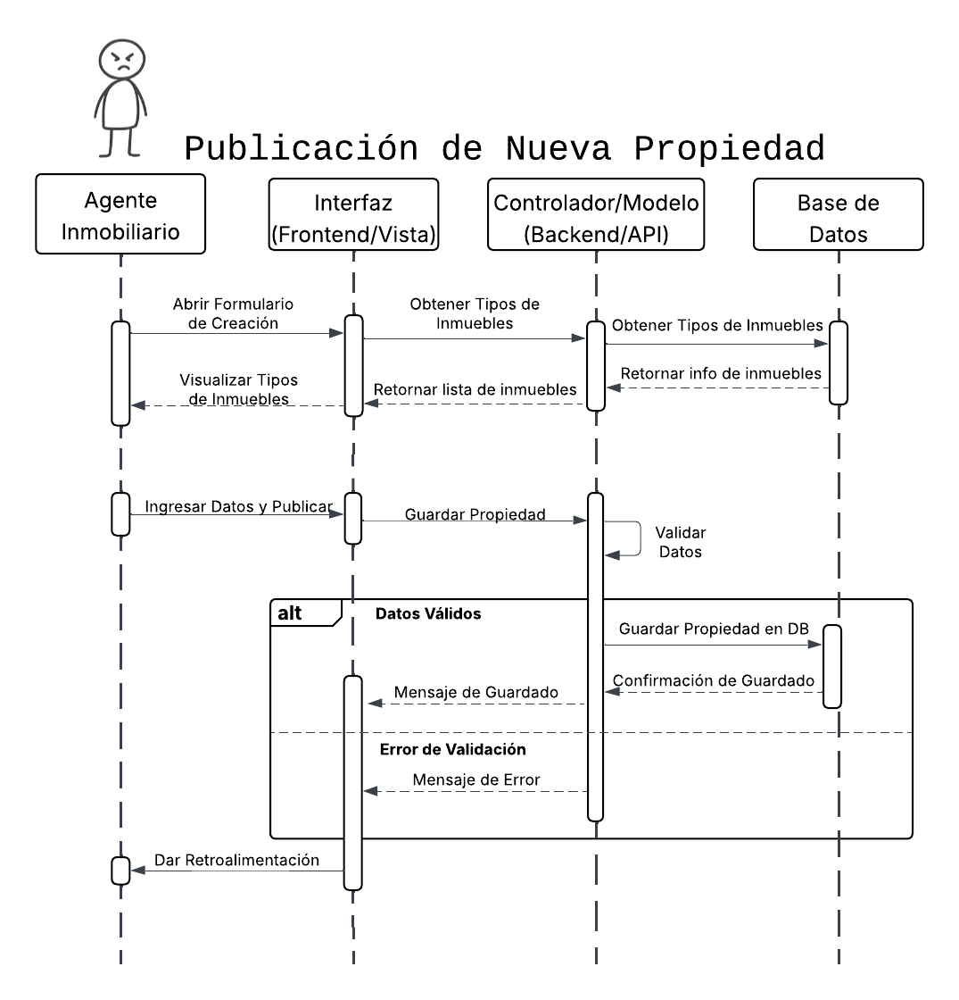

Muestra el flujo que realiza un agente al publicar una nueva propiedad: ingreso de datos, validación, carga de fotografías a Supabase Storage, almacenamiento en BD y confirmación. **CDU relacionado**: CDU001.1.

#### 8.1.2 Negociación de Cita

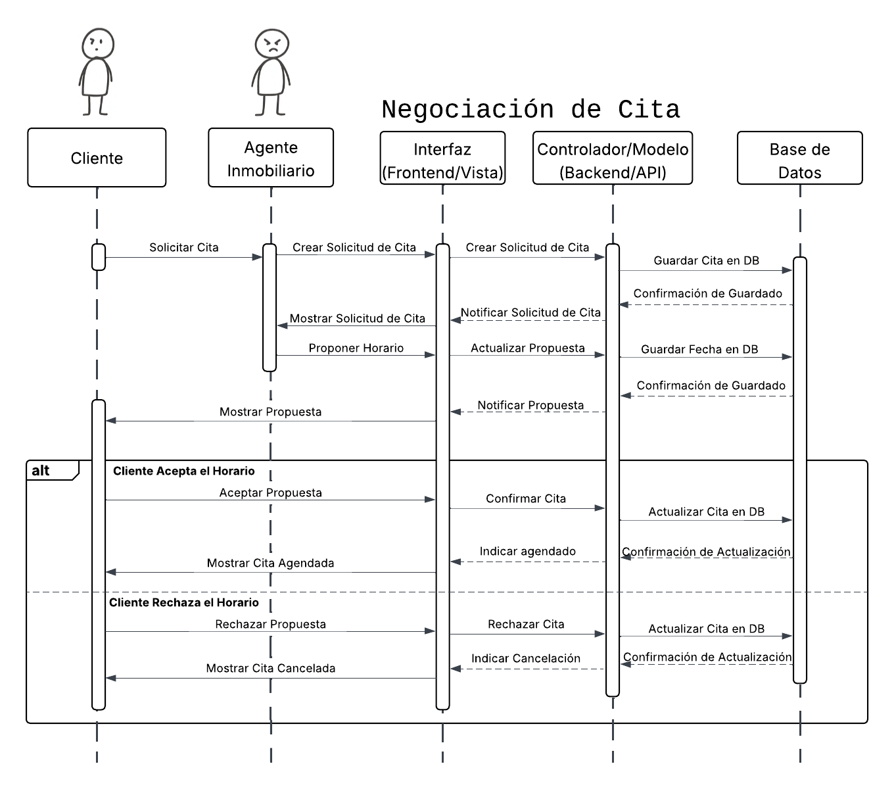

Representa el ciclo de solicitud y negociación de citas: el cliente solicita una cita, el agente puede aceptar o proponer un horario alternativo, y el cliente acepta o rechaza con justificación. **CDU relacionados**: CDU002.0, CDU002.1, CDU002.2.

------

